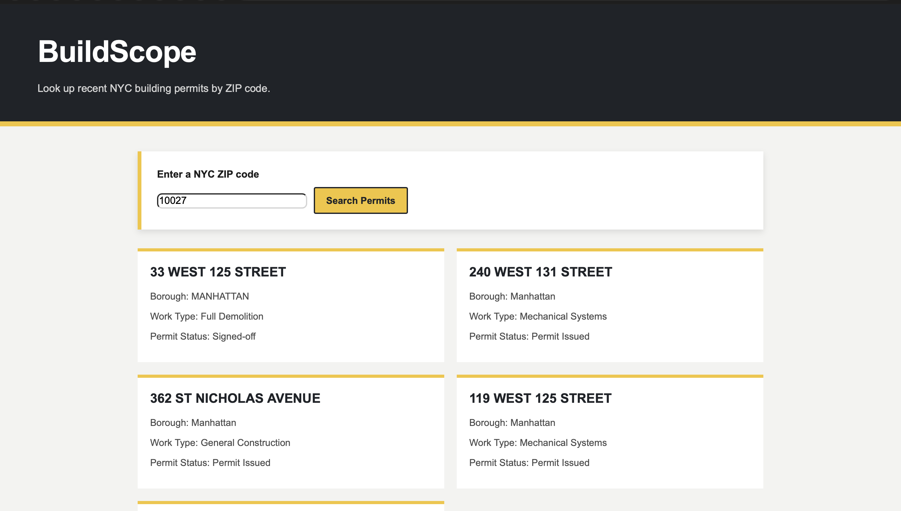

# 🏗️ Project: Simple API 1 - Construction

### Goal: Build a simple front-end app that displays data returned from an api that would be beneficial to someone in the trades (construction, hvac, plumbing, ect)

### How to submit your code for review:

- Fork and clone this repo
- Create a new branch called answer
- Checkout answer branch
- Push to your fork
- Issue a pull request
- Your pull request description should contain the following:
  - (1 to 5 no 3) I completed the challenge
  - (1 to 5 no 3) I feel good about my code
  - Anything specific on which you want feedback!

Example:
```
I completed the challenge: 5
I feel good about my code: 4
I'm not sure if my constructors are setup cleanly...
```

---

## My Solution

**BuildScope – NYC Permit Lookup** is a front-end application that helps users look up recent New York City building permit information by ZIP code.

The application takes a NYC ZIP code entered by the user, retrieves relevant permit data through the NYC Department of Buildings open-data API, and presents the returned information in an easy-to-read format.



## How It's Made

**Tech used:** HTML, CSS, JavaScript, APIs

The application accepts a ZIP code through the search interface and makes an API request for relevant NYC building permit data. JavaScript handles the asynchronous request, processes the returned data, and dynamically renders useful permit information to the DOM.

## What I Learned

This project gave me additional practice working with APIs, handling asynchronous JavaScript, using dynamic user input to construct requests, extracting useful information from returned API data, and rendering results to the DOM.